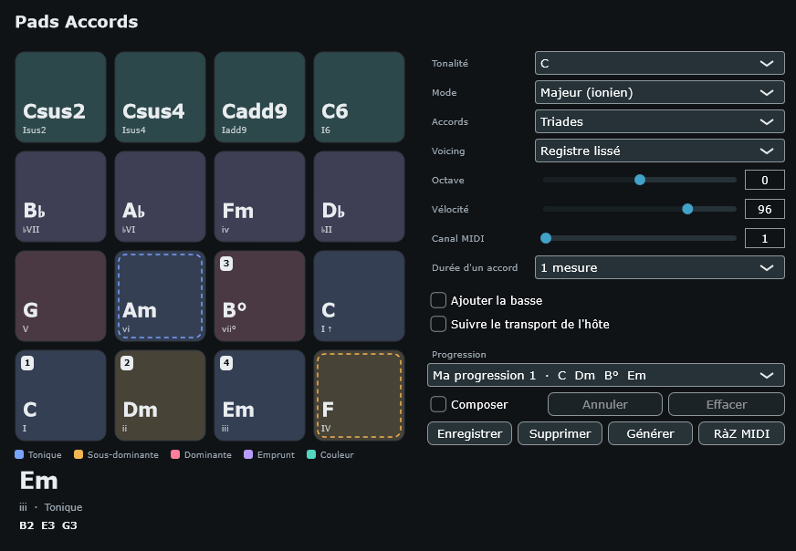

# Pads Accords

[](https://github.com/pieroudeillac/pads_chord/actions/workflows/build.yml) [](LICENSE)

Le compagnon des claviéristes qui veulent des accords tout prêts : un plugin MIDI (VST3, et AU sur macOS) construit pour Ableton Live. Une grille 4×4 façon MPC, un accord par pad, avec des progressions suggérées selon la tonalité et le mode.

> 🇬🇧 English version: [README.md](README.md)

**Le plugin ne produit aucun son** — il pilote en notes MIDI l'instrument de votre choix.



## Fonctionnalités

- **Grille 4×4 de pads** reconstruite pour la tonalité choisie (12) et le mode (ionien, dorien, mineur naturel, mineur mélodique…) : toniques, sous-dominantes, dominantes, emprunts et accords de couleur, étiquetés en chiffrage romain
- **Progressions d'usine** pour chaque mode (pop, jazz ii–V–I, Canon, folk…) plus un **générateur aléatoire**
- **Composez les vôtres** : cliquez les pads pour construire la progression pas à pas, enregistrez sous un nom (conservée dans le projet Live), supprimez quand vous voulez
- **Suivre le transport de l'hôte** : joue la progression choisie en boucle, synchronisée sur Live — un accord toutes les 2 temps, 1 mesure ou 2 mesures
- **Réglages de voicing** : transposition d'octave, registre lissé / position serrée / étalé drop 2, basse de tonique en option
- Réglages généraux : vélocité, canal MIDI, triades / 7es / 9es
- Se joue **à la souris**, sur un vrai contrôleur MPC (notes 36–51), ou **au clavier de l'ordinateur**
- **Bouton RàZ MIDI** qui coupe tout (All Notes Off) si des notes restent coincées

## Téléchargement et installation

Récupérez une compilation sur la page [Releases](https://github.com/pieroudeillac/pads_chord/releases) :

- les **versions numérotées** (par ex. `v1.0.0`) sont les stables à conserver ;
- la **« latest »** suit la compilation du code courant.

Téléchargez `PadsAccords-Windows.zip` ou `PadsAccords-macOS.zip` (ou les artefacts `PadsAccords-Windows` / `PadsAccords-macOS` de l'onglet Actions).

| Système | Dézippez et copiez le dossier `Pads Accords.vst3` dans |
|---|---|
| Windows | `C:\Program Files\Common Files\VST3` |
| macOS | `~/Library/Audio/Plug-Ins/VST3` (ou `/Library/Audio/Plug-Ins/VST3` pour tous les utilisateurs) |

Dans Live : **Préférences → Plug-ins**, activez l'analyse du dossier VST3, cliquez *Rafraîchir*. Si macOS bloque le fichier téléchargé : `xattr -dr com.apple.quarantine "Pads Accords.vst3"`.

## Brancher dans Live (Live Lite compris)

Live ne connaît pas les plug-ins VST « effet MIDI » : le plugin se présente donc comme un **instrument qui produit du MIDI**, sur une piste A, qui alimente **l'instrument d'une piste B** :

1. Créez une piste MIDI **A** et glissez **Pads Accords** dessus (rubrique *Plug-ins → Instruments*).
2. Créez une piste MIDI **B** avec l'instrument qui doit jouer les accords.
3. Sur la piste B, choisissez **MIDI From** = piste A, puis **Pads Accords** dans le second menu. Passez **Monitor** sur *In* et armez la piste.
4. Jouez : cliquez les pads. Avec un vrai contrôleur de type MPC branché sur la piste A, les notes 36–51 (do1 à ré♯2) déclenchent les pads 1 à 16.

**Suivre le transport :** cochez *Suivre le transport de l'hôte* et la progression choisie tourne en boucle, calée sur la position de Live — un accord toutes les 2 temps, 1 mesure ou 2 mesures. Pour la capturer, armez la piste B et enregistrez.

**Composer et enregistrer vos progressions :**

- **Composer** : quand le bouton est actif, chaque clic sur un pad ajoute un accord à la progression (8 au maximum) en le jouant. **Annuler** retire le dernier pas, **Effacer** repart de zéro ; le menu Progression affiche l'entrée « Composée ».
- **Enregistrer** : nommez la progression affichée — elle est sauvegardée dans le projet Live et réapparaît dans le menu **Progression**, à la suite des préréglages d'usine. **Supprimer** n'agit que sur une progression enregistrée.
- **RàZ MIDI** : coupe immédiatement tout ce qui sonne (note-off et *All Notes Off* sur chaque canal) et remet à zéro le MIDI du plugin — utile si le synthé garde des notes bloquées.

**Clavier de l'ordinateur :** cliquez d'abord dans la fenêtre du plugin pour qu'elle ait le focus, puis les touches pilotent les pads du bas vers le haut : `Z X C V` (pads 1–4), `A S D F` (pads 5–8), `Q W E R` (9–12) et la rangée des chiffres `1 2 3 4` (pads 13–16). Une lettre correspond à l'étiquette affichée sur la touche (AZERTY ou QWERTY) ; sur AZERTY, la rangée des chiffres sans Maj (`& é " '`) fonctionne aussi. Maintenez la touche pour tenir l'accord.

## Compiler depuis les sources

Prérequis : **git**, **CMake ≥ 3.22** et un compilateur C++17 (MSVC 2019+, Xcode, ou gcc/clang). JUCE 8.0.8 est récupéré automatiquement à la première compilation.

```sh
cmake -B build
cmake --build build --config Release
```

Tests du moteur de théorie (sans JUCE) :

```sh
ctest --test-dir build -C Release --output-on-failure
```

Le plugin sort dans `build/PadsAccords_artefacts/Release/` (VST3, et AU sur macOS).

**Créer une version numérotée :** posez un tag et poussez-le — la CI compile et publie une version stable automatiquement :

```sh
git tag v1.0.0
git push origin v1.0.0
```

## Organisation du projet

| Chemin | Rôle |
|---|---|
| `Source/ChordEngine.*` | moteur de théorie musicale autonome — C++ pur, vérifié contre le prototype web de référence (324 combinaisons tonalité/mode/type) |
| `Source/PluginProcessor.*` | paramètres, sortie MIDI, suivi du transport, progressions sauvegardées |
| `Source/PluginEditor.*` | interface (grille de pads, affichages, menu des progressions) |
| `tests/` | tests unitaires du moteur et comparateur C++/JS contre le prototype |

## Licence

Copyright © 2026 Pierre-Yves R. — publié sous [GNU AGPL-3.0](LICENSE). Ce plugin s'appuie sur le framework [JUCE](https://juce.com/) 8, utilisé ici selon les termes de la licence JUCE AGPL v3.
